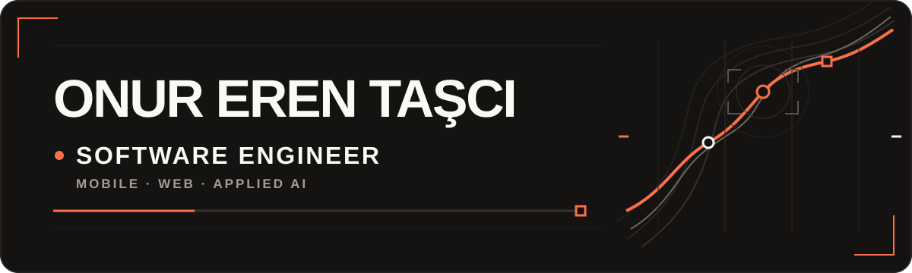
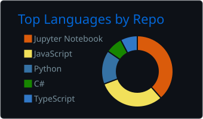
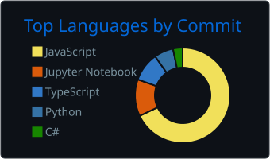

  

  <a href="https://onurerentasci.com/"><strong>Portfolio</strong></a>
  &nbsp;·&nbsp;
  <a href="https://vespula.com.tr/en"><strong>Vespula</strong></a>
  &nbsp;·&nbsp;
  <a href="https://www.linkedin.com/in/onurerentasci/"><strong>LinkedIn</strong></a>
  &nbsp;·&nbsp;
  <a href="mailto:onurerentasci@gmail.com"><strong>Email</strong></a>

  
  
  
  

## Mobile products, web platforms and applied AI

I'm a software engineer based in **Samsun, Türkiye**, working with [Vespula Software Studio](https://vespula.com.tr/en). I build mobile experiences with React Native, Expo and TypeScript, and applied AI systems with Python.

My work connects product interfaces, APIs and AI components: camera features, subscriptions, real-time communication, on-device computer vision and enterprise knowledge retrieval. I also work on store releases, deployment workflows and production support.

### Building with Vespula

At Vespula, I contribute to both our own products and client projects across mobile, web, backend and AI. The projects below reflect team work; my portfolio describes my contributions in more detail.

### Selected products

| Project | What I work on |
| --- | --- |
| **[ULAK](https://ulak.gg/)** | A Turkish community communication platform bringing text, voice, video channels and screen sharing to a web/PWA experience. |
| **[TreasureHunterX](https://apps.apple.com/tr/app/treasure-hunter-x/id6756039082?l=tr)** | A mobile app for scanning and managing collectibles. React Native/Expo development, API integration, RevenueCat subscriptions, EAS updates and Sentry monitoring. |
| **[NannAI](https://onurerentasci.com/en#projects)** | My Software Engineering graduation project: on-device YOLO11 food-image analysis in a React Native nutrition assistant, with Llama 3.1 and product-data APIs. |
| **Kök-Zeka** | On-device AI components for an educational robotics platform combining modular kits and block coding, including object-recognition and voice-command teaching workflows. |

### Client work with Vespula

| Project | Scope |
| --- | --- |
| **[LMED Healthcare](https://lmed.com.tr/)** | A corporate website and medical-product catalogue, with product, brand, service and dealer pages. |
| **[LMED Store](https://www.lmed.com.tr/magaza)** | A Next.js e-commerce experience with catalogue, search, cart, account and promotional workflows. |
| **[Balcona Home](https://balconamoda.com/)** | A furniture and lighting catalogue connecting product discovery with WhatsApp sales enquiries. |
| **[Dinamik Bilişim](https://dinamikbilisim.com.tr/)** | A corporate website for ERP and custom-software services, with references, contact flows and content administration. |

### R&D and research

- **UMAP** — A Turkish enterprise language-model project focused on private knowledge bases. I contribute to its **RAG and GraphRAG** components. Our team submitted the project to **TÜBİTAK BİGG**.
- **Integrated Education Ecosystem** — An R&D initiative designed to connect a student AI assistant, teacher analytics and parent/administrator experiences through a custom LLM core. Our team submitted the initiative to **TÜBİTAK BİGG**.
- **IAC 2026** — I presented an analytical study of edge/cloud inference placement for environmental monitoring at the International Astronautical Congress in Antalya.

[Explore all projects, including DreamLab, Melodine and İkarus →](https://onurerentasci.com/en#projects)

### Core stack

  <strong>Mobile</strong>
    
  &nbsp;&nbsp;
  &nbsp;&nbsp;
  &nbsp;&nbsp;
  &nbsp;&nbsp;
  &nbsp;&nbsp;
  

  <strong>AI &amp; vision</strong>
    
  &nbsp;&nbsp;
  &nbsp;&nbsp;
  &nbsp;&nbsp;
  

  <strong>Web, backend &amp; delivery</strong>
    
  &nbsp;&nbsp;
  &nbsp;&nbsp;
  &nbsp;&nbsp;
  &nbsp;&nbsp;
  &nbsp;&nbsp;
  &nbsp;&nbsp;
  &nbsp;&nbsp;
  &nbsp;&nbsp;
  &nbsp;&nbsp;
  

### Beyond product development

- At **İkarus ARGE**, I developed Python/PyQt5 ground-control software with MAVLink telemetry and OpenCV components, and served as team captain. Our team won the **TÜBİTAK 2242 Defence, Space & Aerospace category** and reached the **TEKNOFEST 2023 Fighting UAV final**.
- I have taught **Python, data analysis, image processing and applied machine learning**, alongside IoT and embedded programming.
- **BSc in Software Engineering**, Samsun University, 2025.

### GitHub activity

<!-- Generated daily by .github/workflows/profile-summary-cards.yml -->

  

  
  

   
  Building a mobile product, a web platform or an applied AI system?
   
  <a href="mailto:onurerentasci@gmail.com"><strong>Let's talk →</strong></a>

